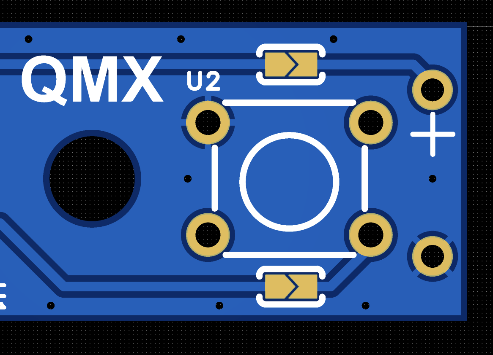
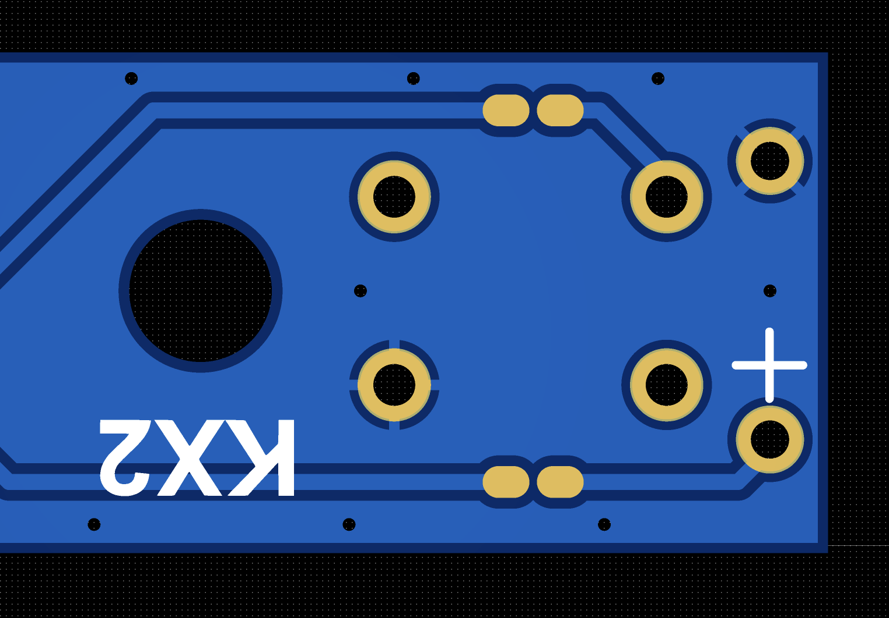

# PTTini PCB information

## QMX version

Wired for the QMX, (tr)uSDX, uSDX and Pebble HF.

## KX2 version

Wired for the KX2, KX3, BG2FX, FX-4CR, zBitx, sBitx and LARCSET.

## Electret fit

The housing is designed around a pocket for the AOM-5024L-HD-F-R electret capsule. Other electrets may fit, but please check that your chosen capsule fits the housing before building. The STEP files are provided so you can check the fit, or modify the housing to suit.

## DUAL version

The DUAL PCB has traces on both sides of the board, so it is a 4-layer PCB: the additional layers maintain a ground plane beneath every trace. As a result, it costs more to manufacture. The Gerber was revised 25/11/26 11:47z (improved solder bridges).

Next to the PTT button, each side of the board has two solder bridges. To set the wiring, bridge both gaps with solder on the side that matches your radio:

- **Top side, labelled "QMX":** QMX wiring.
- **Bottom side, labelled "KX2":** KX2 wiring.

**Ordering note:** because of its dual-purpose design, the DUAL PCB triggers a ratline error in EDA. The schematic appears correct, but I have not ordered this version myself, so I cannot confirm its manufacturing or functional accuracy.

---

Designed by M9OMS.
Licence: Strictly CC BY-NC-SA 4.0.
