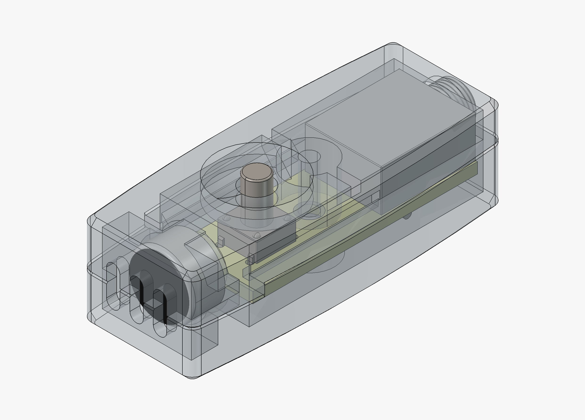

# PTTini
**An open (ish) source, stripped back version of the M9OMS MyTiMic.**

    

The same mini mic, stripped back: **PCB based, with a PTT tactile switch, an electret capsule and a threaded 3.5 mm jack**. The housing has been changed, for easier printing on an ordinary home FDM printer.

Whilst it doesn't have the MyTiMic's PTT debounce or bypassing, it retains the stitched ground planes. All files are available below. ** KX2, and 'DUAL' versions of the PCB have been added**. Future revisions will focus on the housing if changes need to be made.

**Size:** approx. 46.7 × 18.8 × 14.5 mm assembled.

**MyTiMic - full version** https://m9oms.com/product/mytimic_v_1-microphone/

---

## BOM & Gerber:
**https://github.com/radio-uncensored/PTTini/tree/main/Bom_Gerber**

Please read 'PCB_info.md' before downloading.

## STEP Files:
**https://github.com/radio-uncensored/PTTini/tree/main/STEP**
| File | What it is | Updated |
|---|---|---|
| `M9OMS_PTTini_bottom**.step` | Bottom half, already in print orientation | 23/11/26 07:55z | 
| `M9OMS_PTTini_top**.step` | Top half, already in print orientation (roof down) | 23/11/26 07:55z | 
| `M9OMS_PTTini_full_assy**.step` | Both halves assembled with the PCB and electret, for editing in CAD | 23/11/26 07:55z | 
| `changelog.md` | Housing change log | 23/11/26 07:55z | 

PrusaSlicer, Bambu Studio and OrcaSlicer should open the files directly.

---

## Print settings

- **Material:** PLA or PETG
- **Nozzle:** 0.4 mm
- **Layer height:** 0.12–0.2 mm (0.12 gives the nicest dish)
- **Walls:** at least 4 perimeters, so the 1.5 mm walls print solid
- **Infill:** any; the walls do the work
- **Elephant-foot compensation:** on, if your slicer has it
- **Brim:** not needed

**Supports**
- **Top half:** supports **only in the PTT dish** (the shallow recess on the bed face). Use support painting or a support enforcer, and block supports everywhere else. Remove them gently and lightly sand the dish if needed.
- **Bottom half:** (optional supports in the screw recess).

---

## You'll also need

- **The PTTini PCB** (BOM & Gerber link above), plus
  - AOM-5024L-HD-F-R electret capsule (Ø9.7 × 5 mm)
- **1 × M3 self-tapping screw for plastic, 10 mm long**, pan or button head up to Ø7 mm.
- **Foam disc**, about 2 mm thick and 10 mm across, placed in front of the capsule (optional).

The housing is designed around the specific BOM  above - substitutes may not fit.

---

## Design notes

- The halves meet on the jack's centre line at the rear and on the electret's centre line at the front, so both are held evenly.
- Clearances are sized for FDM:
  - 0.2 mm on the locating rails
  - Ø4.5 mm button hole for the Ø3.5 mm plunger
  - Ø7.26 mm jack hole for the Ø6.0 mm jack nose
- The side walls bow out slightly and all four corners are rounded, to resist warping and corner lifting.
- A 0.8 mm chamfer on the bed edges hides elephant's foot. A small groove where the halves meet hides any slight mismatch.

---

Designed by M9OMS.
Licence: Strictly CC BY-NC-SA 4.0.
